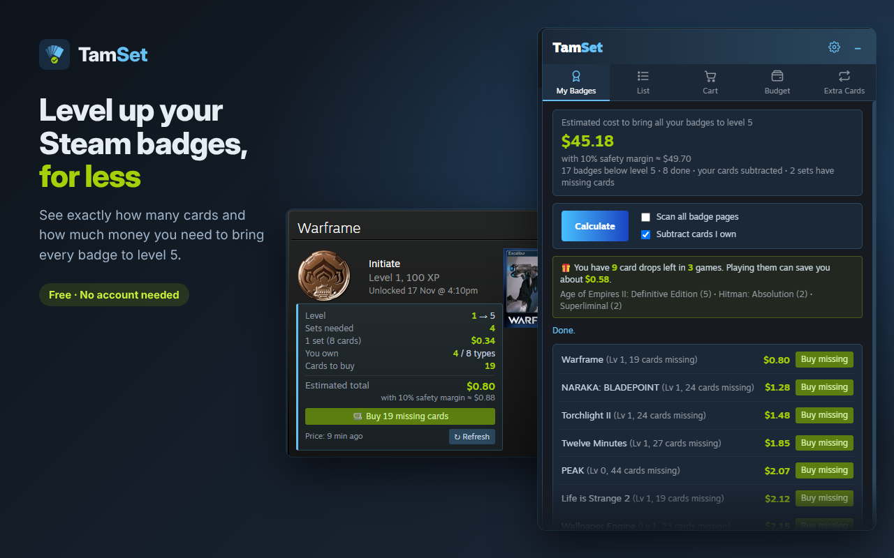

# 🏅 TamSet

**A free browser extension that shows what it costs to level up your Steam badges, and helps you get there for less.**

TamSet adds a clean, simple panel to your Steam badges page and a small shortcut to every Steam page. It works entirely in your browser: no account, no sign-up, no server.

## ✨ What's new in 1.1.0

- 🎨 A completely redesigned, cleaner and smoother interface, and a new logo
- 🎯 Level goal: the cheapest way to the profile level you want
- 📈 Price tracking with a chart in Find Games
- 📦 Purchase result: reopen the cards that could not be bought at today's price
- 💎 Estimated badge value on Steam profiles
- 🧭 A TamSet shortcut and a short tour on every Steam page
- 🔓 A clear warning and one-click fix when browser site access is turned off

## 🚀 Features

- 🏅 **My Badges:** total cost to bring every badge to level 5, with a detailed breakdown under each badge. Cards you already own are subtracted, and ready badges can be crafted with one click.
- 🛒 **Cart:** collect the games you want, choose "+1 level" or "Up to level 5", and see the total cost, XP and your new profile level. Open every missing card on a single Market page.
- 💵 **Budget plan:** enter an amount and TamSet picks the badges that give you the most levels for it.
- 🎯 **Level goal:** enter the profile level you want and TamSet finds the cheapest way there.
- 🔍 **Find Games:** browse thousands of badge sets sorted by price (data from SteamCardExchange) and track any game's set price on a chart.
- 📦 **Purchase result:** after a bulk buy on the Market, see which cards could not be bought and reopen them at today's price.
- 💎 **Badge value on profiles:** an estimated value of a profile's badges.
- 💰 **Extra cards:** see how much you can make by selling the cards you don't need.
- 💳 **Custom wallet amount (optional):** add exactly the amount you need to your Steam Wallet. Off by default.

🛡️ Prices are refreshed before you buy, a safety margin is added to estimates, and TamSet never buys anything by itself. It only opens Steam's own pages, where you confirm.

🌐 Available in **English** and **Turkish**.

## 📥 Install

**[Add TamSet to Chrome – Chrome Web Store](https://chromewebstore.google.com/detail/okgjcnlnmgpkmhedddemljibgojagkko)**

It also works in other Chromium-based browsers that support the Chrome Web Store, such as Brave, Edge and Opera.

After installing, open your Steam badges page (https://steamcommunity.com/my/badges/) and the TamSet panel appears on the right.

## 🐞 Report a bug or suggest a feature

Open an [issue](https://github.com/KaiRagee/tamset/issues). Please include:

1. what you did,
2. what you expected to happen,
3. what happened instead (a screenshot helps).

## 🔒 Privacy

TamSet does not collect or send your data anywhere. Settings, tracked games and your cart are stored only in your browser. See the full [privacy policy](https://kairagee.github.io/tamset/privacy.html).

## ☕ Support

TamSet is free. If you find it useful and want to support further development, you can [buy me a coffee](https://buymeacoffee.com/kairagee).

---

### 🇹🇷 Türkçe

TamSet, Steam rozetlerini 5. seviyeye çıkarmanın ne kadara mal olacağını gösteren ve bunu daha ucuza yapmana yardım eden ücretsiz bir tarayıcı eklentisidir. Rozet maliyeti, sepet, bütçe planı, seviye hedefi, en ucuz setler ve fiyat takibi, toplu alım sonucu, profilde rozet değeri, fazla kartlar ve isteğe bağlı özel cüzdan tutarı özelliklerini içerir. Tüm veriler yalnızca tarayıcında saklanır.

📥 Chrome Web Store'dan yükle: https://chromewebstore.google.com/detail/okgjcnlnmgpkmhedddemljibgojagkko

🐞 Hata bildirmek veya öneride bulunmak için [buradan](https://github.com/KaiRagee/tamset/issues) bir "issue" aç.

---

*TamSet is not affiliated with, endorsed or sponsored by Valve Corporation or SteamCardExchange. Steam is a trademark of Valve Corporation.*
